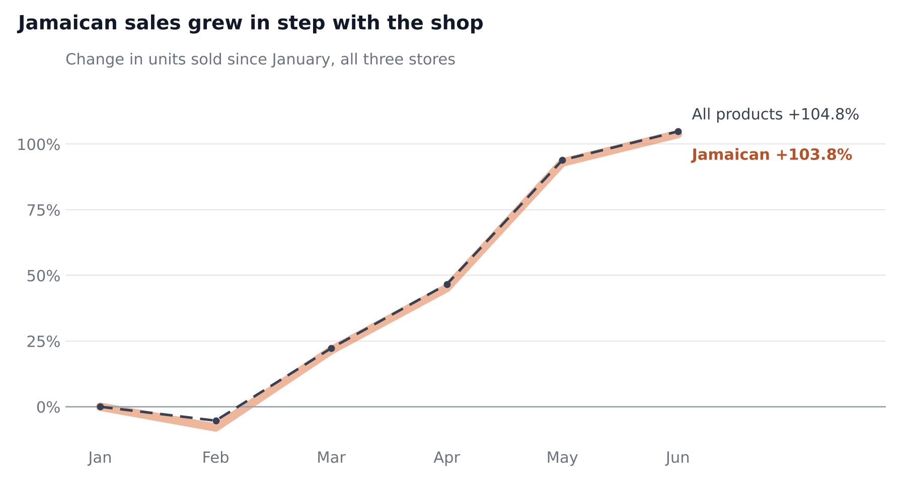
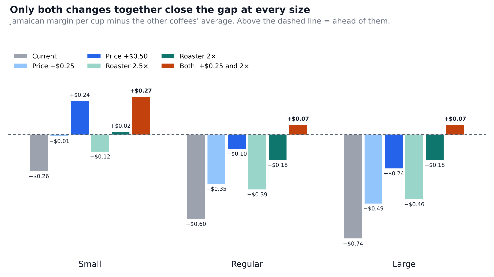

# Maven Premium Coffee Pilot: Business Brief

**To:** Director of Operations · **Consulted:** Finance, Procurement · **Prepared by:** Shey, Business Analyst

## Executive summary

Jamaican Coffee River should stay on the menu, but its margin per cup needs to come up through a cheaper roaster and a small price increase.

From January to June 2023, Jamaican brought in more revenue than any other single-origin coffee (26.5% of coffee revenue), and its share of coffee cups held near 24% every month in every store. Margin is the problem:

- Jamaican keeps 52% of its revenue as margin, against 75% to 83% for Brazilian, Colombian and Ethiopian.
- Its price premium falls short of its extra bean cost at every size, by $0.26 per cup on Small up to $0.74 on Large.
- If each Jamaican cup had earned the same margin as the other coffees in its size, Maven would have made $6,741 more over six months.
- Jamaican still earns the lowest margin even if bean costs are a third lower than estimated.

**Recommendation: Modify.** Demand is healthy, but margin per cup is below the other coffees' average at every size and in every store. Move Jamaican to a cheaper roaster and raise its price by $0.25 at every size. Applied to January to June, the two changes together would have added $8,405 in margin and put every size ahead of the other coffees per cup. The price increase still pays off as long as fewer than 11% of Jamaican cups are lost.

**Risks:** the price scenarios assume sales would have held, and the 2× roaster is the optimistic end of the range. Real savings depend on roaster quotes.

## How margin was calculated

Margin per cup = selling price − bean cost − cup, lid and sleeve. It covers direct costs only, not labor or rent.

Bean cost = grams of roasted coffee ÷ 0.82 × import price per kg ÷ 1,000 × 3

| Input | Value | Basis |
| --- | --- | --- |
| Bean price | 2023 US import price per kg, by origin | WITS trade data |
| Roast loss | Beans lose 18% of their weight (÷ 0.82) | Typical industry range |
| Roaster markup | 3× import price (2× also tested) | Estimate covering shipping, roasting and roaster margin |
| Coffee per cup | 13, 19.5 and 26 g for 8, 12 and 16 oz | About 55 g per liter brewed |
| Cup, lid and sleeve | $0.18, $0.21 and $0.24 by size | Approximate case pricing |

Example, Jamaican Regular: 19.5 g ÷ 0.82 = 23.78 g of green beans × $17.74 per kg × 3 = $1.27 bean cost, plus $0.21 for the cup = $1.48 per cup.

## Findings

All figures cover January 1 to June 30, 2023, across Astoria, Hell's Kitchen and Lower Manhattan.

### Do customers want it?

Yes. Demand is steady in every store.

- Highest revenue of the four coffees: $38,781, against $37,747 for Brazilian, $37,726 for Ethiopian and $32,309 for Colombian.
- Share of coffee cups held near 24% every month.
- Sales doubled from January to June, in step with each store's overall growth.
- Hell's Kitchen is the softest market: Jamaican grew 97.7% there, against 105.3% for the store.

*Sources: Q1, Q3a to Q3c, Q7a to Q7c, 03_analysis.sql*

### Does each cup earn enough?

No. The price premium doesn't cover the extra bean cost at any size.

| Size | Price premium | Extra cost per cup | Shortfall per cup |
| --- | --: | --: | --: |
| Small | $0.32 | $0.58 | −$0.26 |
| Regular | $0.27 | $0.87 | −$0.60 |
| Large | $0.42 | $1.16 | −$0.74 |

- Jamaican beans import at about four times the price of Brazilian beans ($17.74 against $4.01 per kg).
- A Jamaican Large earns less margin than a Brazilian Small.

*Sources: Q1, Q4, Q5, 03_analysis.sql*

### What does the gap cost?

$6,741 in margin across all three stores over six months, compared with what the other coffees earn per cup on the same sizes.

- Large cups account for almost half of the gap.
- Jamaican buyers choose Large slightly more often: 35% of their cups, against 33% for the other coffees.

*Sources: Q6, Q8, 03_analysis.sql*

### Is the finding reliable?

Yes. With every coffee's beans a third cheaper (a 2× markup instead of 3×), Jamaican still earns the lowest margin.

- Jamaican: 66% of revenue, against 81% to 86% for the others.
- The gap narrows from 23 to 31 points to 15 to 20 points, but doesn't close.

*Sources: C1, C2, 04_scenarios.sql*

## Options

Each option replays January to June 2023 with the change applied. Figures are not a forecast.

| Option | Six-month margin effect | Main risk |
| --- | --- | --- |
| Keep as is | Jamaican keeps earning $6,741 less than the other coffees would on the same cups | The gap continues, and grows with sales |
| Raise price $0.25 | +$3,108 if sales hold | Breaks even if 13% of Jamaican cups are lost; Regular and Large stay behind |
| Raise price $0.50 | +$6,216 if sales hold | Breaks even at a 23.5% loss; Large stays $0.24 behind per cup |
| Cheaper roaster | +$5,297 at 2×; +$2,649 at 2.5× | No sales risk, but depends on finding the deal; Regular and Large stay behind |
| **Cheaper roaster and $0.25 increase** | **+$8,405 if sales hold** | Price part pays off only if fewer than 11% of cups are lost |
| Discontinue | Gives up $38,781 in revenue and $20,268 in margin | Unknown share of buyers would switch to another coffee rather than leave |

*Sources: A1 to A3, B1 to B3, D1 to D3, 04_scenarios.sql; Q1, Q6, 03_analysis.sql*
