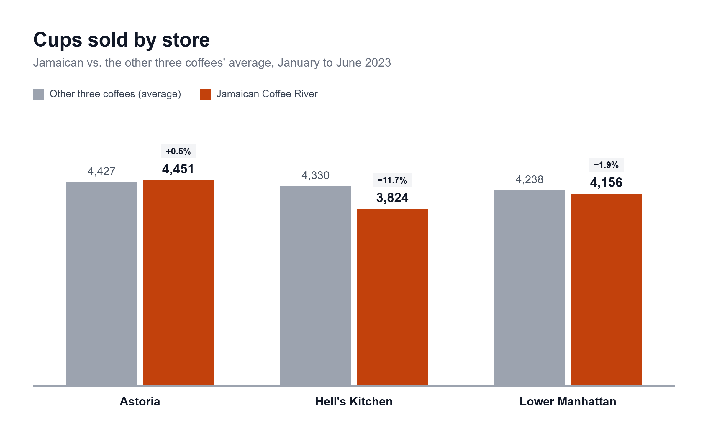
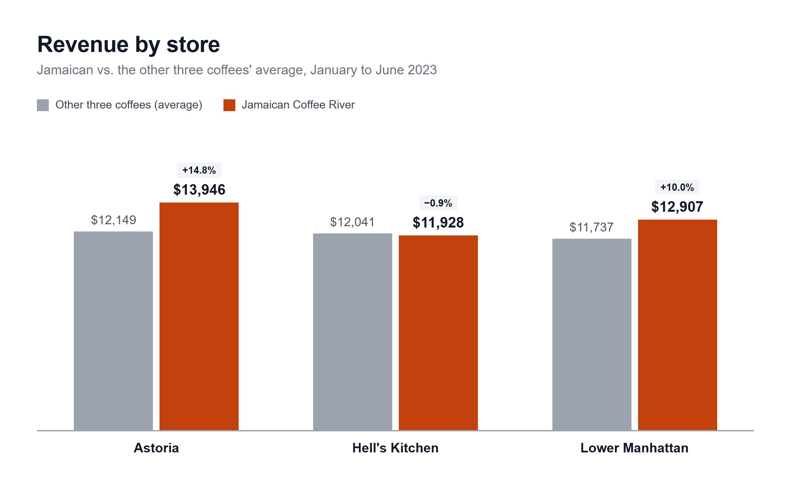
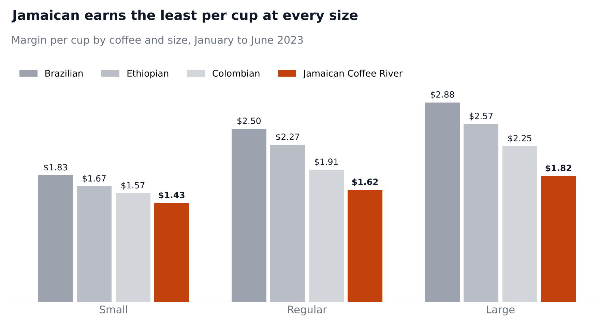
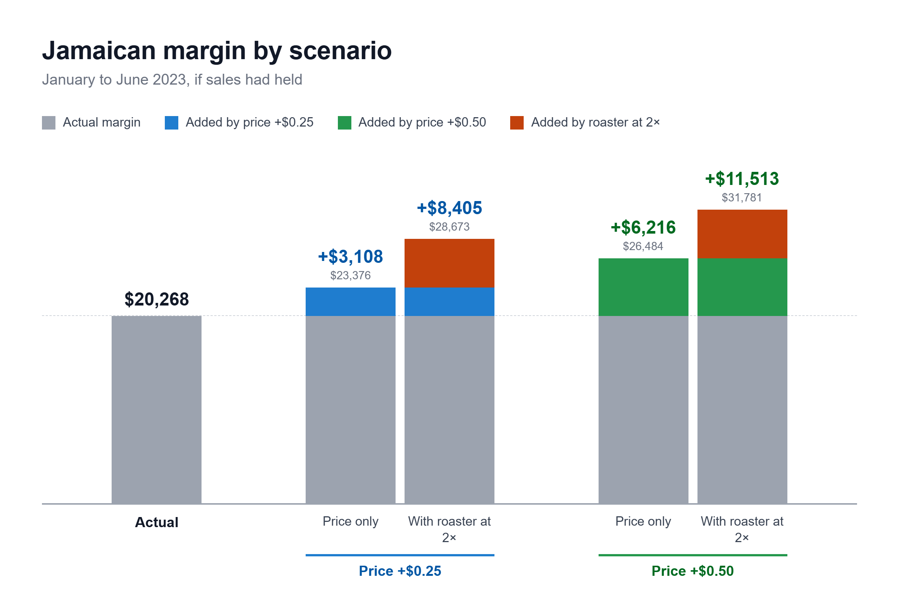

# Maven Premium Coffee Pilot: Business Brief

**To:** Director of Operations · **Consulted:** Finance, Procurement · **Prepared by:** Shey, Business Analyst

## Executive summary

Jamaican Coffee River should stay on the menu, but its margin per cup needs to come up through a cheaper roaster and a small price increase.

From January to June 2023, Jamaican Coffee brought in more revenue than any other single-origin coffee (26.5% of coffee revenue), and its share of coffee cups held near 24% every month in every store. Margin is the problem:

- Jamaican Coffee keeps 52% of its revenue as margin, against 75% to 83% for Brazilian, Colombian and Ethiopian.
- Its price premium falls short of its extra bean cost at every size, by $0.26 per cup on Small up to $0.74 on Large.
- If each Jamaican Coffee cup had earned the same margin as the other coffees in its size, Maven would have made $6,741 more over six months.
- Jamaican Coffee still earns the least per cup if bean costs are a third lower. 

**Recommendation: Modify.** Demand is healthy, but margin per cup is below the other coffees' average at every size and in every store. Move Jamaican Coffee to a cheaper roaster and raise its price by $0.25 at every size. From January to June, a cheaper roaster and a $0.25 price increase would have earned Maven $8,405 more on Jamaican Coffee. The price increase still pays off as long as fewer than 11% of Jamaican Coffee sales are lost.

**Risks:** the price scenarios assume sales would have held, and the 2× roaster is the optimistic end of the range. 

## How margin was calculated

Margin per cup = selling price − bean cost − cup, lid and sleeve. It covers direct costs only, not labor or rent.

Bean cost = grams of roasted coffee ÷ 0.82 × import price per kg ÷ 1,000 × 3

| Input | Value | Basis |
| --- | --- | --- |
| Bean price | 2023 US import price per kg, by origin | WITS trade data |
| Roast loss | Beans lose 18% of their weight (÷ 0.82) | Typical industry range |
| Roaster markup | 3× import price (2× also tested) | Estimate covering shipping, roasting and roaster margin |
| Coffee per cup | 13, 19.5 and 26 g for 8, 12 and 16 oz | About 55 g per liter brewed |
| Cup, lid and sleeve | $0.18, $0.21 and $0.24 by size | Approximate case pricing |

Example, Jamaican Regular: 19.5 g ÷ 0.82 = 23.78 g of green beans × $17.74 per kg × 3 = $1.27 bean cost, plus $0.21 for the cup = $1.48 per cup.

## Findings

All figures cover January 1 to June 30, 2023, across Astoria, Hell's Kitchen and Lower Manhattan.

### Do customers want Jamaican Coffee?

Yes. Demand for Jamaican is steady with its share held near 24% every month, and its sales grew in step with the shop. Hell’s Kitchen is the one soft spot, where Jamaican also grew slower than the store (97.7% vs. 105.3%).

  
  

*Sources: Q1, Q3a to Q3c, Q7a to Q7c, 03_analysis.sql*

### Does each cup earn enough?

No. The menu premium doesn’t cover the cost of the beans. Jamaican beans import at over four times the price of Brazilian, and the shortfall grows with cup size because bigger cups use more beans.

*Sources: Q1, Q4, Q5, 03_analysis.sql*

## Options

**Modify price:** A price increase alone leaves Jamaican Regular and Large behind the other coffees. Paired with a roaster that charges a third less for Jamaican beans, either increase puts every size ahead of them.

**Keep price as is** and Jamaican keeps earning $6,741 less than the other coffees would on the same cups, and the gap grows as sales grow.
**Discontinue the pilot:** Maven gives up $38,781 in revenue and $20,268 in margin. 

*Sources: A1 to A3, B1 to B3, D1 to D3, 04_scenarios.sql; Q1, Q6, 03_analysis.sql*
